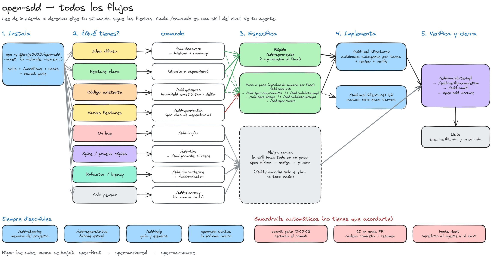
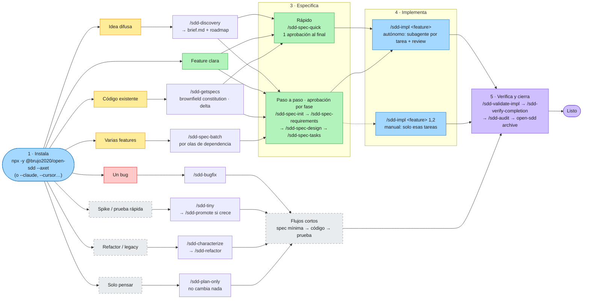

# open-sdd

`open-sdd` is the layer that makes an AI coding agent's "done" verifiable: executable gates, delta
specs for code that already exists, and a constitution that validates every spec.

[](https://github.com/Brujo2020/open-sdd/blob/main/LICENSE)
[](https://github.com/Brujo2020/open-sdd/actions/workflows/gates.yml)

**English** · [Español](README.es.md)

## The problem

AI agents write code fast, and their "it is finished" is a claim nobody checks.
Prompt-only spec-driven tools produce documents, and a document does not fail a build.
This tool turns the claim into something executable: a gate decides pass or fail, and a control that
is declared but not implemented is reported as declared instead of counted as green.

## Install and the first 60 seconds

```bash
npx @brujo2020/open-sdd init . --write
```

Run it inside your repository. It detects the host agent, records the rigor level in
`.sdd/settings/rigor.json`, installs the commit gate (`.git/hooks/pre-commit`) and — with no MCP, no
network and no API key — the **22 prompt templates** as the host's own chat commands. It is
plan-first: without `--write` it only prints the plan, and it never overwrites an existing file. To
install the host's skills too, add `--skills`; `open-sdd integrate <host> --write` installs the skills
**and** registers the MCP server (`--list` shows all 25 hosts, each with a verified registration).

Want to see the flow before installing it? `open-sdd templates` lists all 22 workflows, what each one
writes, and the directory each of the eleven hosts reads. MCP is opt-in (`--mcp`): a host that blocks
it, or a security policy that allow-lists it, does not lose any workflow.

**Coming from the unscoped `open-sdd` package?** That older install declared the same three command
names, and its symlinks survive its own uninstall — so `npm install -g @brujo2020/open-sdd@latest`
stops with `EEXIST: file already exists … /bin/sdd`. Remove the dangling links, install again, and
clear the shell's command cache, which still points at the old binary:

```bash
rm -f "$(npm prefix -g)/bin/sdd" "$(npm prefix -g)/bin/sdd-open"   # left behind, both dangling
npm install -g @brujo2020/open-sdd@latest
hash -r                       # zsh: rehash — or open a new terminal
open-sdd --version            # must print v3.5.0, not the 2.x banner
```

A stale global is not cosmetic: the installed commit hook resolves its CLI through `PATH`, so an old
one makes the gate report nothing while the configuration still reads "blocking" (G-36). Details in
[docs/guides/migration-guide.md](docs/guides/migration-guide.md#7-coming-from-the-unscoped-open-sdd-package).

Then the one door. No arguments, read-only: it prints a 0–100 SDD score, the current phase and ONE
next action, with one line of why.

```bash
open-sdd                 # SDD score, phase and the single next action
open-sdd status          # the same state as a full panel
open-sdd --help          # every command
```

The console messages are currently Spanish; `--lang en` fully translates `open-sdd tour` and
`open-sdd context` only. The commands above work from the published package. In this checkout,
replace `open-sdd` with `node tools/open-sdd/dist/cli.js`.

Optional: the 60-second demo, offline, in a throwaway temp directory.

```bash
git clone https://github.com/Brujo2020/open-sdd && cd open-sdd
bash scripts/demo-60s.sh
```

It injects four real incoherences — an untraced requirement, a completed task with no evidence, an
unfilled `{{…}}` marker, a declared contract that does not exist — and exits non-zero if the tool
misses any of them.

## Every flow at a glance

[](docs/diagrams/open-sdd-flows.excalidraw)

Read it left to right: pick your situation, follow the arrows. Every `/command` is a skill in your
agent's chat. Underneath, the commit gate, the PR checks and (in Axet) the hooks run on their own. The
editable source is [`docs/diagrams/open-sdd-flows.excalidraw`](docs/diagrams/open-sdd-flows.excalidraw):
open it at [excalidraw.com](https://excalidraw.com) → *Open*. The same map in Mermaid, which GitHub renders:

<details>
<summary>Mermaid version</summary>



</details>

**Axet Plugin in one command:** `npx -y @brujo2020/open-sdd --axet` installs the skills, the `/sdd-*`
workflows that Axet's `/` menu lists, and the hooks that put the gate's verdict in the agent's context
(open Axet's ⚖ panel once so it picks up the workflows). For Cline, `--cline` installs the skills in
`.cline/skills/`. Details in [docs/INSTALL.md](docs/INSTALL.md).

## What you get

- **22 prompt templates, installed by default.** Every workflow is a command in your agent's own chat
  (`/sdd-specify`, `/sdd-converge`, …), and each one runs a real engine command rather than asking a
  model to "consider" a check. No MCP, no network. The argument you type is translated into each host's
  own token (`{{args}}`, `${input:request}`, `$ARGUMENTS`), and a host's documented size limit is
  checked rather than assumed. `open-sdd templates` lists them.
- **An MCP server, if you want one.** A stdio JSON-RPC server with 11 tools and read-only resources,
  callable by any modern MCP host. No network, no model backend, no API keys. It is opt-in (`--mcp`),
  because some hosts and some security policies do not allow it.
- **Delta specs.** `ADDED` / `MODIFIED` / `REMOVED` / `RENAMED`, with delta-scoped `REQ-<AREA>-<NNN>`
  ids, so the contract of change stays finite.
- **A constitution as the pivot.** Every spec is validated against
  `.sdd/steering/constitution.md`; `brownfield constitution --draft` proposes it and a human ratifies it.
- **A rigor ladder.** `spec-first` → `spec-anchored` → `spec-as-source`, fluid by default and
  cumulative: each step only adds gates, and a valid constitution is required at every level.
- **A commit gate and PR checks.** A pre-commit hook over the staged index, and a pull-request
  workflow that runs the full chain.
- **An audit bundle.** One sha256 per artifact plus SARIF 2.1.0; exits non-zero on a blocking finding.
- **On-demand assistants.** Where a command already found a gap — an ambiguous EARS requirement, an
  unfilled marker, a missing constitution — it proposes a paste-ready fix or asks an explicit question.
- **Brownfield adoption.** `brownfield bootstrap` produces a module map, a codebase-intelligence
  document, a reverse constitution and reuse-first candidates.
- **Importers.** `import kiro | spec-kit | cc-sdd` maps incumbent artifacts into `.sdd/` and names
  every skip with its reason.

## How it compares

Qualitative, from the alternatives' public documentation. This is **not a benchmark**.

| | this tool | spec-kit | Kiro | prompt-only skill packs |
|---|---|---|---|---|
| Nature | CLI + MCP engine | prompt/skill toolkit | SDD inside one IDE | prompts and skills |
| Host integration | MCP server; 35 agent definitions, 32 command conventions (20 verified, 12 refused with the URL that failed) plus a declared fork, 26 verified MCP registrations; the 22 prompt templates are the no-MCP default | broad install and integration surface | its own IDE | the host's chat |
| Specs for existing code | delta specs + reverse constitution | spec workflow; a brownfield-bootstrap extension is proposed (#1436) | spec workflow in the IDE | documents only |
| Enforcement | executable gates, exit codes, commit hook + PR checks | prompts and review | IDE-guided workflow | none |
| Requirements & standards | 32 machine-checkable requirements checks and a 16-entry standards catalogue (`standards`, `requirements review`); every finding carries a position, a basis and a graded remedy or an explicit question — and it stays **advisory until a corpus measures its precision**; the count is verified by `CLM-067`, not hand-written | a checklist prompt | IDE quality hints | none |
| Evidence / audit | audit bundle, sha256 per artifact, SARIF | the documents themselves | IDE artifacts | none |
| Offline | no network, no model backend | local templates and scripts | IDE product | host-dependent |

spec-kit does two things this repository does not: a much broader ecosystem and integration surface,
and a gentler learning curve. Kiro's IDE integration is smoother than anything shipped here. If you
live in either, they are good choices; no parity of ecosystem, polish or adoption is claimed.
[Migrate from Kiro, spec-kit and cc-sdd](docs/guides/migrate-from.md) maps their artifacts onto this
one.

### The best of each tool, in one place

open-sdd does not replace these tools by copying them: it takes the one idea each does best, turns it into a
deterministic check or a command where possible, and leaves out what only adds ceremony. Ideas and rules, not code
(all MIT); see [SDD modes](docs/guides/sdd-modes.md) for why each piece is included.

| Tool | What it does best | What open-sdd takes | Where | What it leaves out, and why |
|---|---|---|---|---|
| **Spec Kit** (GitHub) | the constitution as the authority; `/clarify`; `/analyze` across artifacts | constitution required at every governed rung; clarify as bounded questions derived from the deterministic ambiguity findings; cross-artifact consistency as an executable check, not a prompt | `brownfield constitution`, `govern`, `brownfield clarify`, `consistency` | gates written as prompts: here they return exit codes |
| **Kiro** (AWS) | EARS requirements; steering with `inclusion`; three approved phases; Spec / Quick / Bugfix / Plan modes | EARS validation and repair; steering readiness; the sequential stage guide; the four modes as skills | `requirements review/fix`, `steering check`, `stages`, `/sdd-spec-quick`, `/sdd-bugfix`, `/sdd-plan-only` | the IDE itself: open-sdd runs in any host |
| **OpenSpec** (Fission-AI) | change as a delta (ADDED · MODIFIED · REMOVED · RENAMED); `archive` | delta specs with stable ids; archiving verified specs; one behaviour per requirement | `delta init/validate`, `archive`, `requirements review` | applying deltas by hand: `delta` owns it |
| **cc-sdd** (gotalab) | tasks with `(P)`, `_Boundary:_`, `_Depends:_`; waves; no technology in requirements | parallel waves; boundary, dependency and duplicate-id checks; an advisory hint when a requirement names a technology | `waves`, `consistency` | nothing material |
| **BMAD-METHOD**¹ | discovery before building; non-goals; elicitation methods | `brief.md` gate: mandatory non-goals, measurable outcome, unconfirmed assumptions block; append-only decision log | `/sdd-discovery`, `discovery lint/log` | permanent personas and full PRD/architecture ceremony: one agent with lenses is enough |
| **Feathers** (*Working Effectively with Legacy Code*) | characterization tests | freeze current behaviour before touching untested legacy | `/sdd-characterize`, `brownfield contracts` | — |
| **SteelForge IDE** | levels and flows people pick first; tinyspec; EARS → Gherkin | `explore` mode outside the ladder; skills by project type; acceptance scenarios traced to each REQ | `modes`, `/sdd-tiny`, `/sdd-promote`, `gherkin` | — |

¹ "BMAD-METHOD" and "BMad" are trademarks of BMad Code; the name is used only to identify the source of the ideas.
Kiro's documentation could not be read directly; its ideas come through cc-sdd and Kiro's published modes.

## What it does not do yet

- **Module discovery is Node-only.** Workspace roots come from `package.json`; Maven/Gradle, Go, Rust
  and Python monorepos return a single root module from `brownfield bootstrap`.
- **Impact analysis has known false-positive classes.** `brownfield impact` reads the import graph
  and the delta, and a check with that noise level can train its readers to ignore it.
- **Three command-template conventions are refused, not guessed.** Codex, Zed and Cline document no
  project-scoped command directory, so `init --write` prints the convention it could not verify and
  writes nothing there. `open-sdd templates` lists all eleven hosts and marks each one.
- **A local `docker build` is still single-architecture.** It produces the builder's architecture; the
  multi-arch image (`linux/amd64` + `linux/arm64`) is built and pushed by the CI container job, so it
  requires GitHub's runners rather than a laptop.
- **The measurements are synthetic.** `docs/MEASUREMENTS.md` records 10/10 injected classes caught on
  repositories this project wrote — self-consistency, not field recall or precision. The paper's
  κ/FPR/latency figures belong to an unpublished prototype and are not measurements of this repository.
- **The commit floor is installed, but level A is not verified.** The hook and the PR matrix exist
  and run; no behavioural sentinel has verified write-time blocking in any host, and
  `git commit --no-verify` is not recorded.

The complete list of gaps (G-01 … G-33), each with its code location, is in
[docs/PAPER-ALIGNMENT.md](docs/PAPER-ALIGNMENT.md).

## Documentation

[Install](docs/INSTALL.md) · [Quickstart (60 s)](docs/guides/quickstart-60s.md) ·
[Integrations](docs/guides/integrations.md) · [Existing projects](docs/guides/existing-projects.md) ·
[Migrate from Kiro / spec-kit / cc-sdd](docs/guides/migrate-from.md) ·
[Measurements](docs/MEASUREMENTS.md) · [Paper alignment and gaps](docs/PAPER-ALIGNMENT.md) ·
[Español](README.es.md) · [Changelog](CHANGELOG.md)

## License

MIT — see [LICENSE](LICENSE).
